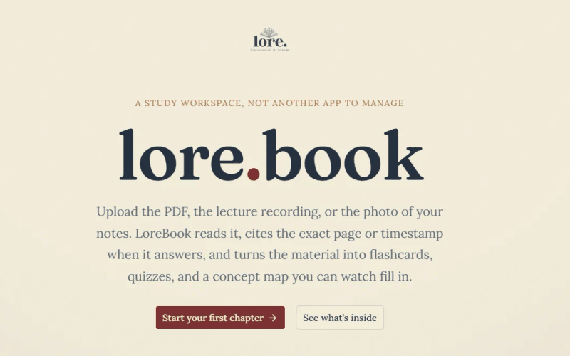
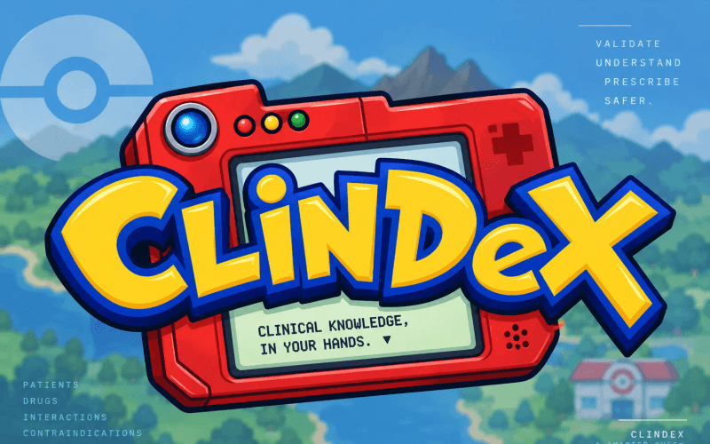
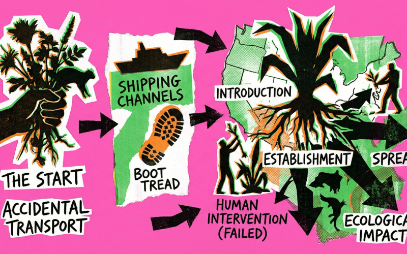
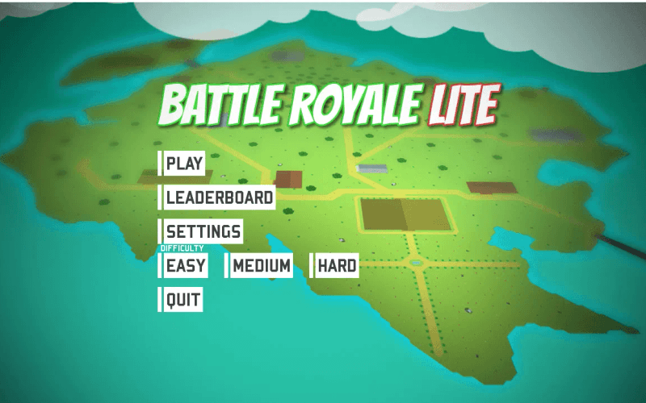
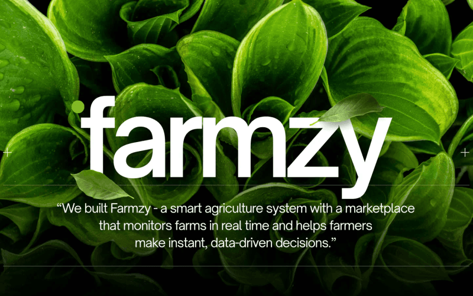

B.Tech CSE (Artificial Intelligence) at SIMATS, Chennai · 2024 – 2028

## 🧭 About me

I build software that solves real problems, from AI study tools and clinical decision support to games and hardware-backed dashboards. I learn fastest by shipping, and I like projects where AI, data and a usable product meet.

- 🏢 Software Development Intern at **Zoho**, building for **Site24x7**
- 🧠 Building RAG-based AI applications with embeddings and LLMs
- 🚀 Shipping full-stack products end to end, from database to deployment
- 🎮 Making Java games and polished desktop software
- 📚 Learning modern C++ and production-grade SaaS architecture

## 🛠️ Featured projects

<table>
  <tr>
    <td width="50%" valign="top">
      
      <h3><a href="https://github.com/JoanathanPS/lorebook">LoreBook</a></h3>
      An AI study workspace. Drop in PDFs, notes or lectures and chat with them, make flashcards and quizzes.
        
      <code>Gemini</code> <code>RAG</code> <code>Supabase</code>
        
      <a href="https://lorebook.joanathan.in/">Live</a> · <a href="https://github.com/JoanathanPS/lorebook">Code</a>
    </td>
    <td width="50%" valign="top">
      
      <h3><a href="https://github.com/JoanathanPS/clindex">ClinDex</a></h3>
      AI-assisted prescription review. Reads the medication, asks for missing patient context and flags risky interactions.
        
      <code>RxNorm</code> <code>LLMs</code> <code>Healthcare AI</code>
        
      <a href="https://clindex.joanathan.in/">Live</a> · <a href="https://github.com/JoanathanPS/clindex">Code</a>
    </td>
  </tr>
  <tr>
    <td width="50%" valign="top">
      
      <h3><a href="https://github.com/JoanathanPS/alienbuster">AlienBuster</a></h3>
      Invasive species early warning. Citizen photos plus Sentinel-2 NDVI to catch vegetation anomalies. Built in 24 hours.
        
      <code>Sentinel-2</code> <code>NDVI</code> <code>Computer Vision</code>
        
      <a href="https://alienbuster.joanathan.in/">Live</a> · <a href="https://github.com/JoanathanPS/alienbuster">Code</a>
    </td>
    <td width="50%" valign="top">
      
      <h3><a href="https://github.com/JoanathanPS/battleroyale">Battle Royale</a></h3>
      A Java battle royale I extended with smarter bots, loot, a shrinking safe zone and a minimap. Plays in the browser.
        
      <code>Java</code> <code>LibGDX</code> <code>Game AI</code>
        
      <a href="https://battleroyale.joanathan.in/">Play</a> · <a href="https://github.com/JoanathanPS/battleroyale">Code</a>
    </td>
  </tr>
  <tr>
    <td width="50%" valign="top">
      
      <h3><a href="https://github.com/JoanathanPS/Farmzy">Farmzy</a> 🏆</h3>
      Smart agriculture with real-time soil monitoring and a marketplace. Hackathon winner. I led software as Software Head.
        
      <code>IoT</code> <code>ThingSpeak</code> <code>Node.js</code>
        
      <a href="https://farmzy.joanathan.in/">Live</a> · <a href="https://github.com/JoanathanPS/Farmzy">Code</a>
    </td>
    <td width="50%" valign="top">
      
      <h3><a href="https://github.com/JoanathanPS/FundMeUp">FundMeUp</a></h3>
      A crowdfunding platform. Create a campaign, share it, collect support, with auth and campaign workflows.
        
      <code>Full-Stack</code> <code>Auth</code> <code>Database</code>
        
      <a href="https://fundmeup.joanathan.in/">Live</a> · <a href="https://github.com/JoanathanPS/FundMeUp">Code</a>
    </td>
  </tr>
</table>

## 🏆 Achievements

| Year | Result | Project |
|---|---|---|
| 2025 | 🥇 **Winner**, Next Gen Product Buildathon (SQ1 Security & AI Geeks) | Farmzy |
| 2025 | 🏅 **Top 5**, Hackforge Hackathon (DDGDVC) | Farmzy |
| 2026 | ⚡ Built in 24 hours at NXTGEN'26, International Software Innovation Hackathon (SRMIST, Logitech) | AlienBuster |

## 🧰 Tech stack

 
 
 

Plus Generative AI, RAG, embeddings, NumPy, Pandas and REST APIs

## 📈 GitHub activity

<picture>
  <source media="(prefers-color-scheme: dark)" srcset="https://raw.githubusercontent.com/JoanathanPS/JoanathanPS/output/snake-dark.svg" />
  <source media="(prefers-color-scheme: light)" srcset="https://raw.githubusercontent.com/JoanathanPS/JoanathanPS/output/snake.svg" />
  
</picture>

## 🤝 Let's connect

Open to collaborations, internships and interesting side quests. And if you need a website, I'd love to build it.

